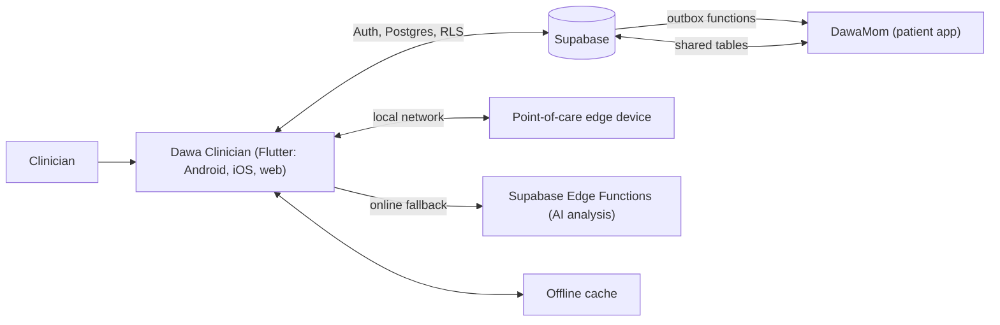

# Dawa Clinician: a point-of-care clinical workspace for maternal health

[](LICENSE.txt)

Dawa Clinician is the clinician-facing Flutter app from [Dawa Health](https://dawa-health.com/). It is the care-team companion to **DawaMom**, the maternal health app for patients: appointment requests that patients make in DawaMom come through to clinicians here, and Dawa Clinician is the source of the clinician details DawaMom shows when a patient books. Clinicians also use it to register patients, record encounters and run point-of-care diagnostics, with or without an internet connection.

> Dawa Clinician supports clinical work. It is not a medical device and does not replace professional clinical judgment. See [Clinical safety](#clinical-safety).

## Contents

1. [What it does](#what-it-does)
2. [How it works](#how-it-works)
3. [How the app was built](#how-the-app-was-built)
4. [How it connects to DawaMom](#how-it-connects-to-dawamom)
5. [Tech stack](#tech-stack)
6. [Getting started](#getting-started)
7. [Runtime configuration](#runtime-configuration)
8. [Repository layout](#repository-layout)
9. [Testing and verification](#testing-and-verification)
10. [Supabase notes](#supabase-notes)
11. [Project documentation](#project-documentation)
12. [Clinical safety](#clinical-safety)
13. [Data protection](#data-protection)
14. [Troubleshooting](#troubleshooting)
15. [Contributing](#contributing)
16. [License](#license)

## What it does

- **Patient registry.** Register mothers, search and filter the registry, and open a patient's details and history.
- **Encounters.** Record and edit clinician-owned clinical observations.
- **Appointments.** Review appointment requests from DawaMom, schedule appointments, and see today, upcoming and past appointments in a calendar.
- **Service catalog.** Administrators manage the services clinicians offer, and the catalog is synced to DawaMom.
- **Point-of-care diagnostics.** Anemia, cervical cancer screening and ultrasound, plus CT scan and blood pressure monitoring modules.
- **Offline use.** Core workflows keep working when the connection drops, and results sync when it returns.
- **Accounts and roles.** Clinician sign-in, secure registration completion, administrator tools and a profile area.

## How it works



### What happens during one screening

1. The clinician picks a patient and a tool from the care tools screen. Tools that need a patient show a prompt if none is selected.
2. The image or measurement comes from the edge device, or from the camera or gallery where a tool allows it.
3. The analysis runs on the edge device first. When the device is unavailable, the tool's analysis policy decides whether an online fallback through a Supabase Edge Function is allowed.
4. The result is shown with its details. For cervical screening the clinician can request a second opinion.
5. The result is saved to Supabase. If the app is offline it is queued locally and synced later.
6. A cervical scan can be kept as a draft and finished later.

The exact fallback rules are written down per tool in the docs listed under [Project documentation](#project-documentation).

## How the app was built

The main design decisions, and why they were made.

### 1. Started in FlutterFlow, then moved to hand-maintained Flutter

The project began as a FlutterFlow export and runs on the Flutter stable release. The generated pages and helpers are still in `lib/flutter_flow/`. New work lives in `lib/application/` (screens and modules), `lib/features/` (newer features organised by layer), `lib/components/` (shared UI) and `lib/services/` (device, offline and repository services). The newer `lib/features/appointments/` splits code into `data/`, `domain/` and `presentation/`, and that is the pattern new features should follow.

### 2. Moved from Firebase to Supabase without rewriting every screen

The backend moved from Firebase to Supabase (Auth, Postgres, Row Level Security and Edge Functions). Many screens were written against Firestore-style records and queries, so `lib/backend/supabase/supabase_firestore_compat.dart` keeps those calls working on top of Postgres. Contract tests (`legacy_query_contract_test.dart`, `legacy_record_contract_test.dart`) pin that behaviour so a change to the compatibility layer cannot silently break old screens. User accounts carry their original Firebase id (`add_firebase_uid_to_users` migration), and the scripts used for the data move are kept in `tools/firebase_to_supabase/`.

### 3. One database shared with DawaMom, synced through Edge Functions

DawaMom and Dawa Clinician share Supabase tables, and Edge Functions move data between the two platforms:

| Function | Purpose |
|---|---|
| `sync-dawa-mom-patient` | Brings DawaMom patient changes into the clinician registry |
| `receive-dawa-mom-appointment` | Receives appointment requests from DawaMom |
| `process-dawa-mom-status-outbox` | Sends appointment status changes back, on a schedule |
| `sync-dawa-mom-risk-alert` | Brings risk alerts raised in DawaMom to clinicians |
| `process-service-catalog-outbox` | Sends service catalog changes to DawaMom, on a schedule |
| `list-bookable-clinicians` | Lists clinicians a patient can book |

Changes that must reach the other app are written to an outbox table and delivered by a scheduled function, so a failed delivery is retried instead of lost. The sync functions have fixture-based tests (`supabase/functions/sync-dawa-mom-patient/fixtures/`, `sync-dawa-mom-risk-alert/index_test.ts`), and `dawa_platform_sync_architecture_test.dart` checks the structure on the Flutter side.

### 4. Screening tools are modules on a shared shell

Each diagnostic is a self-contained module with the same shape: a controller, a repository, a service and a screen (see `application/hemonix/` for anemia and `application/ct_scan/`). Shared pieces live in `application/shared/clinical_tools/` (controller, dashboard, models) and in `components/` (clinical workspace layout, tab bar, image frame, page intro). `care_tool_registry.dart` lists the available tools, so adding a tool means building a module and registering it rather than editing navigation in several places.

### 5. Talking to point-of-care devices

Devices on the clinic's local network are reached through `lib/services/edge_device/` (client, configuration, manager, models, exceptions and image input). The UI shows device state through an indicator and a status banner, and a workflow status component keeps the clinician informed during capture and analysis. Because a browser cannot always reach a device directly, a development proxy (`tool/edge_dev_proxy.dart`) is provided for web builds. The device contract, a hardware self-test script (`tool/device_selftest.sh`) and integration checklists are in `docs/`. Mock-hub tests let the contract be checked without hardware, and separate live tests run against real devices.

### 6. Offline first

Clinics do not always have reliable internet, so reads and writes go through `supabase_offline_cache.dart` and `clinical_offline_store.dart`. `offline_auth_cache.dart` lets a clinician who has signed in before keep working, `offline_connectivity_service.dart` tracks the connection, and an offline status banner tells the clinician what is happening. Results captured offline are synced when the connection returns (`cacx_offline_result_sync_test.dart`, `screening_patient_offline_test.dart`).

### 7. A shared design system, checked at every screen size

`components/dawa_design_system.dart` and `navigation_design_system.dart` hold the colours, spacing and navigation styles, and the DM Sans font is bundled in `assets/fonts/` so the look is the same on every platform. The current brand blue refresh also updates the Android launch screen, the launcher icon and the web manifest. Pages are reviewed in a collapsed sidebar, desktop, laptop, tablet, mobile and large-text layouts, and screenshots from those reviews are kept in `docs/qa/`. `ui_responsive_layout_test.dart` and `light_theme_and_transparent_assets_test.dart` guard the basics.

### 8. Access control and sensitive actions

Row Level Security policies on every shared table decide what a patient, doctor or administrator can read and write. Later migrations harden specific areas, such as anemia authorization, secure completion of clinician registration and a guard on appointment status updates (with a SQL test in `supabase/tests/`). Sensitive administrator actions ask for a PIN confirmation (`components/admin_pin_confirmation/`). Private keys never ship in the app, see [Runtime configuration](#runtime-configuration).

### 9. Tests and coverage as part of the workflow

The `test/` folder holds unit, widget and contract tests for each module, plus live tests that run against real devices or a real Supabase project and are meant to be run on purpose. `tool/verify_coverage.sh` and `tool/coverage_report.py` produce a line-level coverage report, and `tool/coverage_required_sources.txt` lists the source files that must be covered.

## How it connects to DawaMom

The two apps share data through Supabase:

- **Appointment requests.** DawaMom stores patient bookings in `public.appointments` with `status = pending` and `source = dawa_mom`. Clinicians review these requests in Dawa Clinician.
- **Clinical observations.** `public.encounters` holds clinician-owned clinical observations, plus legacy records.
- **Clinician directory.** DawaMom lists bookable clinicians through the `get_bookable_clinicians` RPC, which reads an imported cache of clinician rows. The optional `clinician-directory` Edge Function is the adapter for a future authoritative endpoint served from Dawa Clinician. The interface is described in `docs/dawa-clinician-integration-contract.md` in the DawaMom repository.
- **Access control.** Row Level Security policies cover the patient, doctor and admin roles. A clinician should only see the appointments and records they are allowed to see.

Changes to shared tables, RPCs or RLS policies affect both apps. Test them from DawaMom and from Dawa Clinician before deploying.

## Tech stack

- Flutter stable / Dart (originally generated with FlutterFlow)
- Supabase Auth, Postgres, Row Level Security and Edge Functions
- Android, iOS and web targets
- Point-of-care edge devices on the local network

## Getting started

### Prerequisites

- Flutter stable and the platform tooling for the targets you build (Android Studio, Xcode, Chrome)
- A Supabase project (URL and anon key)
- Optional: the Supabase CLI to apply migrations and deploy functions

### 1. Get the code and dependencies

```powershell
git clone https://github.com/Dawa-Health/dawa_clinician.git
cd dawa_clinician
flutter pub get
```

### 2. Configure Supabase

Set the Supabase project URL and anon key as described in [Runtime configuration](#runtime-configuration), and apply the migrations:

```powershell
supabase db push --linked
```

### 3. Run the app

```powershell
flutter run
```

To run in a browser:

```powershell
flutter run -d chrome
```

To work with a device from a web build, use the development proxy script described in `docs/setup-and-installation.md` (`tool/run_web_dev.sh`).

To build the web app:

```powershell
flutter build web
```

The output is written to `build/web`.

### 4. Local checks

```powershell
flutter pub get
flutter analyze --no-pub
flutter test --no-pub
```

To measure test coverage:

```powershell
flutter test --no-pub --coverage
```

This writes a line-level report to `coverage/lcov.info`.

## Runtime configuration

The app needs a Supabase project URL and anon key. Both are public values and are safe to ship in the Flutter client.

Service-role keys, AI provider keys and any other private keys belong in Supabase Edge Function secrets or backend environment variables. Never put them in Flutter client code. Environment variables and device settings are listed in `docs/environment-variables.md`.

## Repository layout

| Path | Contents |
| --- | --- |
| `lib/application/` | Screens and modules: home, patient registry, encounters, appointments, anemia (`hemonix`), cervical (`cacx`), ultrasound, CT scan, BP monitor, care tools |
| `lib/features/` | Newer features organised by layer (appointments, service catalog) |
| `lib/components/` | Shared UI: design system, navigation, clinical workspace layout, device status widgets |
| `lib/auth/` | Sign-in, registration completion, password reset, administrator account creation |
| `lib/backend/` | Supabase configuration, offline cache, schema records, the Firestore compatibility layer |
| `lib/services/` | Edge device client, offline store, connectivity and screening repositories |
| `lib/flutter_flow/` | Generated FlutterFlow helpers, theme and navigation |
| `supabase/` | Migrations, Edge Functions, SQL tests and admin scripts |
| `firebase/` | Legacy Firebase configuration from before the move to Supabase |
| `tools/firebase_to_supabase/` | Scripts for moving data from Firebase to Supabase |
| `tool/` | Coverage scripts, the edge device development proxy and the device self-test |
| `test/` | Automated tests |
| `docs/` | Project documentation, verification reports and QA screenshots |
| `assets/` | Images, fonts and other bundled files |
| `android/`, `ios/`, `web/` | Platform projects |
| `pubspec.yaml` | Dependencies and app metadata |
| `analysis_options.yaml` | Dart analyzer and lint rules |

## Testing and verification

Before releasing a change:

1. Run `flutter analyze --no-pub` and `flutter test --no-pub`.
2. Check coverage with `tool/verify_coverage.sh` when you touch a covered module.
3. Review changed screens in the collapsed sidebar, desktop, laptop, mobile and large-text layouts.
4. For device work, run the mock-hub tests first, then the live device tests against real hardware.
5. For Supabase changes, check the items under [Supabase notes](#supabase-notes) from both Dawa Clinician and DawaMom.

Live tests (device and Supabase) need real devices or a real project, so they are not part of the default run.

## Supabase notes

Apply migrations to the linked project:

```powershell
supabase db push --linked
```

After changing Supabase-facing code, check:

- Clinician sign-in
- Reading and updating `public.appointments` requests from DawaMom
- Reading and writing `public.encounters`
- RLS policies for patient, doctor and admin roles
- That DawaMom can still list and book clinicians

### Migrating from Firebase

`tools/firebase_to_supabase/` contains the scripts used to move data from the original Firebase backend to Supabase. See that folder for usage.

## Project documentation

| Topic | Where |
|---|---|
| Setup and installation | `docs/setup-and-installation.md` |
| Environment variables | `docs/environment-variables.md` |
| Offline mode | `docs/offline-mode.md` |
| UI architecture | `docs/ui-architecture.md` |
| Edge device contract, integration and handoff | `docs/edge-device-*.md`, `docs/pi_device_integration.md`, `docs/arduino-device-connection.md` |
| Anemia (online fallback and verification) | `docs/anemia-online-fallback.md`, `docs/anemia-verification-*.md` |
| Cervical screening (second opinion, automatic fallback) | `docs/cacx-second-opinion-and-modal-verification.md`, `docs/phase5b-cervical-automatic-fallback.md` |
| Three-model screening integration | `docs/three-model-screening-integration.md` |
| DawaMom patient sync | `docs/dawa-mom-patient-sync.md` |
| Per-phase UX notes | `docs/phase*-*.md` |
| Testing and verification | `docs/testing-and-verification.md` |
| QA screenshots and audits | `docs/qa/` |
| Changelog | `docs/changelog.md` |

## Clinical safety

Dawa Clinician is a support tool, not a diagnostic authority.

- Screening results come from AI models and devices that can be wrong. Treat every result as decision support and confirm it with clinical judgment.
- Show device and connection problems clearly, and never present a stale or fallback result as if it were fresh.
- Review a sample of real screenings with clinicians regularly, and feed corrections back into the models and the app.
- If a patient may be in an emergency, follow your clinic's emergency procedure.

## Data protection

Dawa Clinician handles patient identities, health records and images.

- Row Level Security is on for the shared tables. Keep service-role keys out of source control and the client.
- Offline caches hold patient data on the device. Use device lock screens, and sign out on shared devices.
- Decide how long records and images are kept, and delete them on a schedule that fits your policy.
- Follow the data protection laws that apply where you operate, and tell patients what is stored.
- Screening images may be sent to online analysis when the fallback is used. Take that into account in your privacy notice.
- Never commit patient data, exported records or screenshots that show real patients.

## Troubleshooting

| Symptom | Likely cause and fix |
|---|---|
| Sign-in works but lists are empty | The signed-in account's role does not match the RLS policies, or the migrations are not applied. Run `supabase db push --linked` and check the role |
| Appointment requests from DawaMom do not appear | The sync or receive function is failing, or the outbox schedule is not running. Check the Edge Function logs |
| The device indicator shows offline | The device address or settings are wrong, the device is off, or it is on another network. See `docs/edge-device-communication-audit.md` |
| A web build cannot reach the device | The browser cannot call the device directly. Use the development proxy (`tool/run_web_dev.sh`) |
| A result is missing after working offline | It is still queued. Reconnect and watch the offline status banner until it syncs |
| `flutter analyze` or tests fail after a pull | Run `flutter pub get`, then check `pubspec.lock` for conflicts |

## Contributing

Issues and pull requests are welcome. Please:

- keep changes focused, and work on a branch
- run the local checks before opening a pull request
- describe how you tested the change, including the screen sizes and devices you used
- never commit keys, patient data or private device settings

By contributing to this repository, you agree that your contributions will be licensed under the AGPL-3.0, the same license as the project.

## License

Dawa Clinician is free software released under the [GNU Affero General Public License v3.0](LICENSE.txt) (AGPL-3.0). You may use, study, modify and share it under the terms of that license.

In particular, if you run a modified version of Dawa Clinician as a network service, you must make the corresponding source code of your modified version available to the users of that service, under the same license.

Copyright (C) 2026 Dawa Health.

This program is distributed in the hope that it will be useful, but WITHOUT ANY WARRANTY; without even the implied warranty of MERCHANTABILITY or FITNESS FOR A PARTICULAR PURPOSE. See the GNU Affero General Public License for more details.

Dawa Clinician is not a medical device. It supports clinical work and does not replace professional clinical judgment.

Third-party dependencies keep their own licenses.
